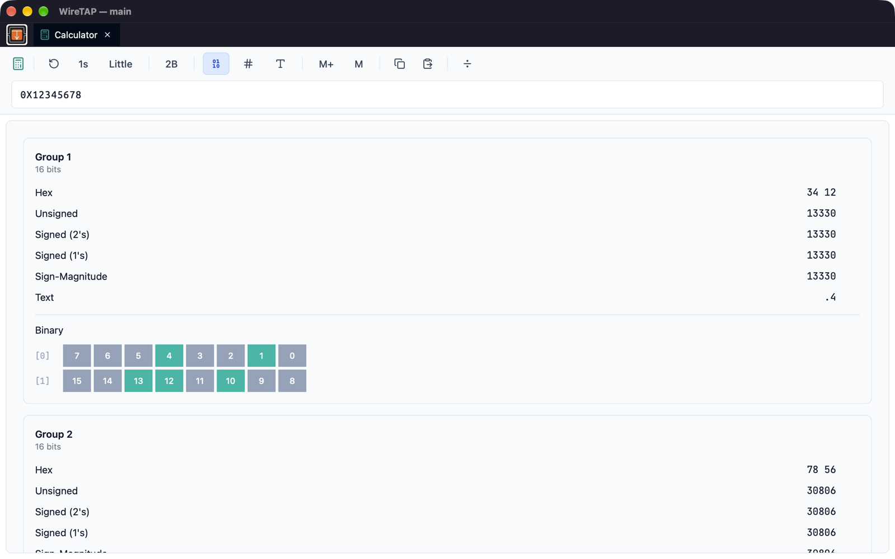

# Calculator

The Calculator is a binary and hex analysis tool for format conversion, byte order exploration, and signal reverse-engineering.

## Overview

When reverse-engineering CAN data, you often need to interpret bytes in different formats and byte orders. The Calculator takes hex input, splits it into groups, and shows every representation of each group at once in the chosen byte order, making it easy to identify how values are encoded.

## Input Modes

Choose the mode with the buttons in the toolbar.

### Hex Input

Enter raw bytes as hex values:
- Space-separated: `12 34 56 78`
- Continuous: `12345678`
- 0x-prefixed: `0x12345678`

Anything that is not a hex digit is ignored.

### Number Input

Enter a decimal or hex number to see its byte representation:
- Decimal: `12345`
- Hex: `0x3039`

The output shows how this number would be stored in the chosen byte order.

### String Input

Enter ASCII text to see its hex representation:
- Input: `Hello`
- Output: `48 65 6C 6C 6F`

## Byte Order Support

Pick the byte order from the **Byte Order** button in the toolbar (default: Little):

| Order | Description | Bytes `12 34 56 78` read as |
|-------|-------------|-----------------------------|
| **Big** | MSB first | `0x12345678` |
| **Little** | LSB first | `0x78563412` |
| **Mid-Big** | Bytes of each 16-bit word swapped, then read big-endian | `0x34127856` |
| **Mid-Little** | Bytes of each 16-bit word swapped, then read little-endian | `0x56781234` |

Mid-endian (mixed-endian) formats are used by some older systems and specific protocols.

## Grouping Modes

Control how bytes are grouped for interpretation from the **Grouping Mode** button (default: 2B):

| Mode | Groups data as |
|------|----------------|
| **1B** | Individual bytes |
| **2B** | 16-bit words |
| **4B** | 32-bit dwords |
| **8B** | 64-bit qwords |
| **Custom** | A list of widths in bits or bytes, e.g. `8,8,16,2,2` or `1,1,2,2` |

## Value Representations

For each group, the Calculator displays:

| Format | Description |
|--------|-------------|
| **Hex** | Hexadecimal |
| **Unsigned** | Unsigned integer |
| **Signed (2's comp)** | Two's complement signed integer |
| **Signed (1's comp)** | One's complement signed integer |
| **Sign-Magnitude** | Sign bit + magnitude encoding |
| **Text** | Character representation |
| **Binary** | Full binary expansion |

Click the copy button beside any value to copy it.

## ByteBits Visualisation

Each group shows an interactive bit-level display:
- Each bit shown individually
- Click bits to toggle them
- Hover to see bit position
- Colour coding for set, cleared and unused bits (set in **Settings → Display**)

## Tools

### Auto-Rotation

Automatically cycle through byte orders at a set interval:
1. Click the interval button and choose 1, 2, 3, 5, 10 or 15 seconds
2. Click the rotate button to start
3. Watch the display cycle through all four byte orders; click again to stop

Useful when you know a value but not its byte order.

### Scale Calculator

Calculate a DBC-style scale factor:
1. Enter the raw bytes in hex input
2. Open the Scale Calculator; it takes the raw value from the first group (unsigned)
3. Enter the physical value it should represent
4. The calculator shows the scale (`physical ÷ raw`), ready to copy into your catalog

It computes a scale only, with no offset.

Example:
- Raw 100 = Physical 50°C
- Result: Scale = 0.5

### Memory

Keep values for comparison:
- **Add to memory** saves the current input
- The **Memory** dialog lists saved values
- Set any item as the active value again, copy it, or delete it
- Copy all items at once

## Common Use Cases

### Finding a Signal's Encoding

You see `B4 00` in a CAN frame and know the value should be 180:
1. Enter `B4 00` in hex input with 2B grouping
2. Compare the unsigned value in each byte order:
   - Big: 46080
   - Little: 180 ✓
3. The signal is little-endian, 16-bit unsigned

### Determining Scale Factor

You know raw `0x64` (100) represents 50 km/h:
1. Enter `64` in hex input
2. Open the Scale Calculator
3. Enter: Physical 50
4. Result: Scale = 0.5
5. Add to catalog: `factor = 0.5`

### Analysing Unknown Bytes

Captured `FF 7F 00 00` and need to identify it:
1. Enter the bytes
2. Check the representations in Little byte order:
   - 4B grouping, signed: 32767 (max int16?)
   - 2B grouping: 32767, 0
3. Likely a 16-bit value followed by padding

## Tips

- Use 2B grouping when analysing CAN signals (most common)
- The Mid-endian formats are rare but exist in legacy systems
- Toggle bits in ByteBits to understand how values change
- Memory is useful for comparing "before" and "after" captures
- Auto-rotate while watching live data to spot the correct byte order

## See Also

- [Catalog Editor](catalog-editor.md) - Use calculated scale in signal definitions
- [Discovery](discovery.md) - Capture frames to analyse
- [Decoder](decoder.md) - Verify your encoding assumptions
