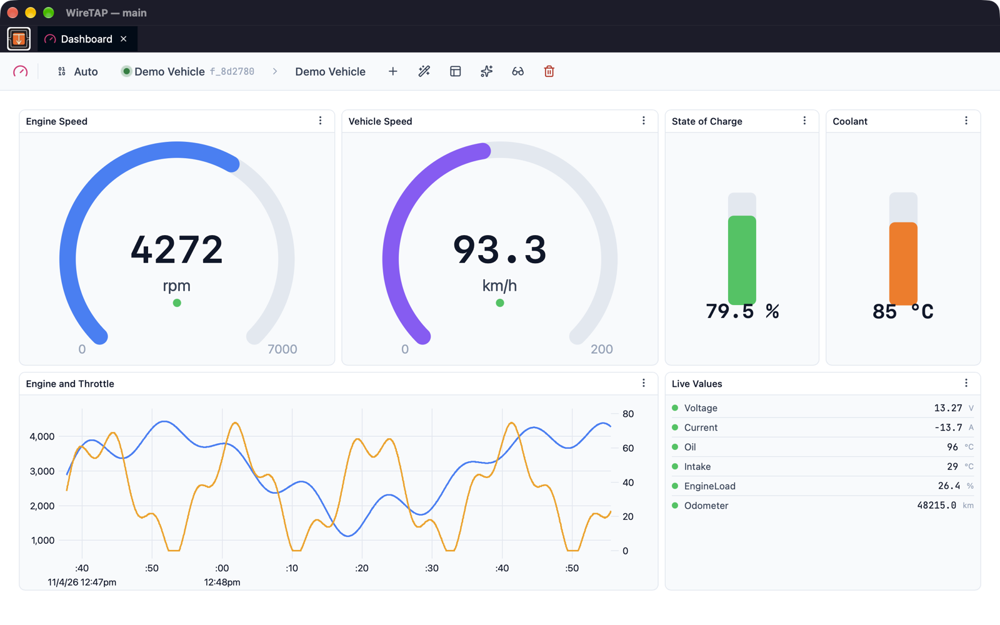

# Dashboard

The Dashboard panel (formerly Graph) visualises CAN data as interactive charts, gauges, instruments and live value lists.

## Overview

Dashboard loads a signal catalog and decodes incoming frames in real time, plotting signal values over time. It supports many panel types arranged in a draggable grid layout, with tools for zooming, measuring, and exporting data. Some panel types work on raw frame bytes and need no catalog, which helps when reverse-engineering. Panels and layouts persist across sessions.

## Panel Types

| Type | Purpose |
|------|---------|
| Line Chart | Time-series plot with zoom, pan, measurements, and statistics |
| Gauge | Radial dial showing current signal values |
| List | Live table of latest signal values |
| Indicator | Maps an enum value to an icon, colour and brightness |
| Rotary / Wheel | Shows a bounded value as a rotation |
| Level Bar | Bar with a readout for a bounded value |
| Histogram | Value distribution of one or more signals |
| Flow View | Plots the raw bytes of one frame ID over time (no catalog needed) |
| Bit Heatmap | Grid of a frame's bits, coloured by how often each changes (no catalog needed) |
| Bitfield | Per-bit on/off view of a frame's latest bytes |
| Custom Canvas / Custom SVG | Draw your own widget with a script, run in a sandbox |

Create panels using the **Add panel** menu in the top bar. Most panels can display multiple signals simultaneously.

## Getting Started

1. **Load a Catalog** — Select a catalog from the dropdown in the top bar
2. **Add a Panel** — Choose a panel type from the Add panel menu
3. **Add Signals** — Open **Configure** from the panel's menu (⋮) and click **Add Signals** to open the signal picker
4. **Start Streaming** — Select a source and begin capture
5. **Interact** — Zoom, pan, measure, and export as needed

To fill a dashboard quickly, **Add catalog signals as instruments** (the wand button) creates a ready-made panel for each signal you pick, using the signal's `display` hint in the catalog or a widget inferred from its range or enum.

## Line Chart Features

### Zoom and Pan

| Interaction | Action |
|-------------|--------|
| Click-drag a region | Zoom into the selected time range |
| Scroll wheel | Zoom in/out centred on the cursor position |
| Shift + left-click drag | Pan the X-axis |
| Middle-click drag | Pan the X-axis |
| Reset zoom (panel menu) | Return to full data range |

Zoom and pan work together — zoom into a region, then pan to scroll through it.

### Follow Mode

During live capture, follow mode automatically scrolls the chart to show the latest data as it arrives. Follow mode is enabled by default.

- Any manual zoom or pan interaction disables follow mode
- Choose **Follow mode** in the panel menu to re-enable it
- Follow mode state persists per panel

### Measurement Cursors

Click twice on a chart to place two measurement cursors. An overlay appears showing:

| Field | Description |
|-------|-------------|
| C1 / C2 | Timestamps of each cursor |
| Δt | Time difference between cursors |
| Per-signal values | Signal value at each cursor position with delta |

- Click a third time to clear both cursors
- Double-click anywhere to clear cursors
- Drag-zoom does not place cursors (small movements are ignored)

### Statistics Overlay

Toggle the statistics overlay with **Show stats** in the panel menu. When enabled, the overlay displays min, average, and max values for each signal in the top-right corner of the chart.

Statistics describe the samples currently on screen.

### Dual Y-Axes

When a panel contains two or more signals, each signal can be assigned to the left or right Y-axis:

1. Open **Configure** from the panel menu
2. Use the **L** / **R** toggle next to each signal
3. Signals on different axes scale independently

The right Y-axis only appears when at least one signal is assigned to it.

## Panel Configuration

Open **Configure** from the panel menu to set:

| Setting | Description |
|---------|-------------|
| Title | Panel display name |
| Signal colour | Colour picker per signal |
| Display name | Override the catalog signal name |
| Signal order | Drag to reorder signals |
| Y-axis (L/R) | Assign signals to left or right axis (line chart, 2+ signals) |
| Min / Max | Value range (gauge, rotary and level bar) |
| Frame ID, byte count | Target frame for raw-byte panels (flow view, heatmap, bitfield) |
| Bin count | Number of bars (histogram, 5–200) |
| Code | Draw function for custom canvas and SVG panels |
| Replace signal | Swap a signal source without removing it |

## Finding Unknown Signals

The sparkle button in the top bar helps when a frame is not yet in a catalog:

- **Quick Candidates** — Pick a frame ID, bit lengths, byte order and a byte range, and generate line-chart panels of every candidate signal (up to four per panel)
- **Hypothesis Explorer** — Sweep a frame's payload (or every discovered frame) for candidate signals of the chosen sizes and byte orders, ranked by how likely they are to be real, and chart the ones you pick

## Export

The panel menu offers:
- **Export CSV** — line charts and flow views
- **Export PNG** or **Export SVG** — panels drawn on a canvas or as SVG

**CSV format:**
- First column: ISO-8601 timestamps to the microsecond (e.g. `2026-02-21T10:30:45.123456Z`)
- Subsequent columns: `Signal Name (unit)`
- Signals with different update rates produce sparse rows — missing values are left empty

A native save dialog opens with a default filename based on the panel title.

## Buffer Size

Configure the per-signal buffer size with **Dashboard Buffer Size** in **Settings → Captures**. The buffer determines how many samples are retained per signal (1,000 to 100,000).

| Size | Use Case |
|------|----------|
| 1,000 | Low memory, short-term monitoring |
| 10,000 | Default — suitable for most sessions |
| 100,000 | Long captures with full history |

When the buffer is full, the oldest data is overwritten. The history belongs to the session, so every Dashboard on the same session shows the same data, and a change to the buffer size applies to signals already charting.

## Layout Management

Panels are arranged in a 12-column draggable grid. Drag panel headers to reposition, drag edges to resize.

**Save and restore layouts** from the **Manage layouts** menu in the top bar:
1. **Save Current Layout** — Name the current panel arrangement, then **Save** it in the app or **File** to write a shareable `.dashboard.json` file
2. **Load** — Click a saved layout or a dashboard file to restore it
3. **Delete** — Remove a saved layout

Panel configurations (signals, colours, axes, follow mode, stats) are included in saved layouts. A layout saved with a different catalog is flagged in the list. Saved layouts can also be renamed or deleted in **Settings → Dashboard Layouts**.

The top bar can also switch to a raw JSON view of the layout for editing or pasting, and remove all panels at once.

## Panel Header

The panel header shows the title and serves as a drag handle. The ⋮ button opens the panel menu:

| Item | Action |
|------|--------|
| Follow mode | Toggle auto-scroll (line chart, flow view) |
| Show / Hide stats | Toggle min/avg/max overlay (line chart, flow view) |
| Reset zoom | Return to full data range (line chart, flow view) |
| Export PNG / SVG / CSV | Save the panel as an image or its data as CSV |
| Configure | Open panel settings |
| Clone | Duplicate the panel |
| Remove | Remove the panel |

## Tips

- Use follow mode during live capture, then disable it to inspect specific events
- Place measurement cursors around an event to see exact signal deltas
- Assign correlated signals to the same panel with dual Y-axes for comparison
- Use a Flow View or Bit Heatmap to see which bytes of an unknown frame are changing
- Export to CSV for offline analysis in spreadsheets or other tools
- Save layouts for different analysis scenarios (e.g. "Engine Signals", "Braking Events")
- Increase the buffer size before long captures to retain full history

## See Also

- [Discovery](discovery.md) — Capture raw frames
- [Decoder](decoder.md) — Decode signals in tabular form
- [Catalog Editor](catalog-editor.md) — Create and edit signal catalogs
- [Settings](settings.md) — Configure buffer size and IO profiles
