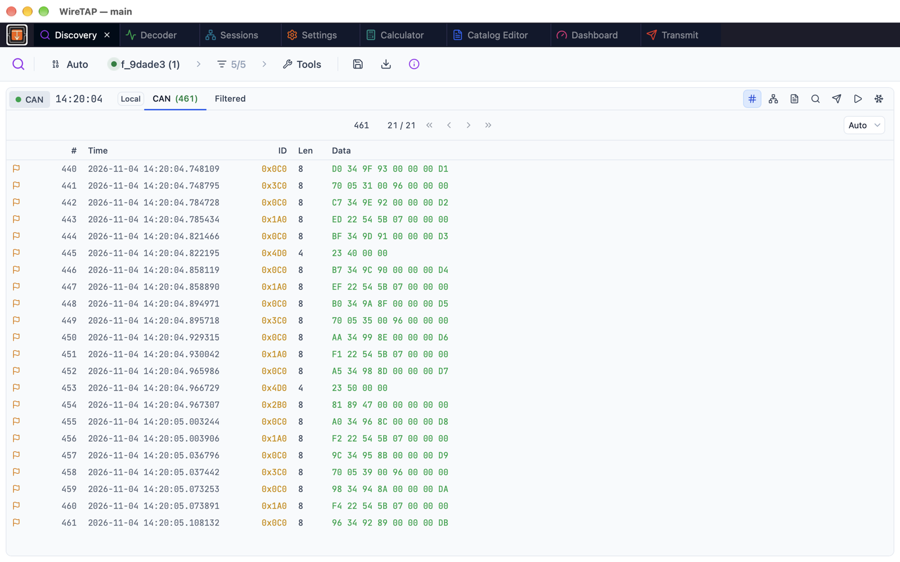
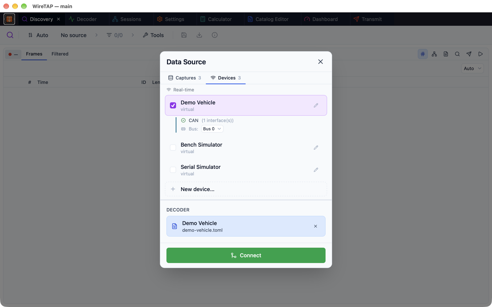

# Discovery

The Discovery panel is your primary tool for capturing and exploring raw CAN, serial or Modbus data from any connected source.

<picture>
  <source media="(prefers-color-scheme: dark)" srcset="images/discovery-dark.png">
  
</picture>

## Overview

Discovery shows frames from its session in a paged table, filling the panel by default (rows per page is set to Auto). Each unique frame ID is tracked, making it easy to identify all message types present on your network. Everything the session receives is written to its capture, so the table, the frame picker, export and the analysis tools all cover the whole run since it started or was last cleared.

## Data Modes

### CAN Mode

Shows CAN and CAN FD frames with:
- **Frame ID** - Standard (11-bit) or Extended (29-bit) identifiers
- **Length** - 0-8 bytes, or up to 64 bytes for CAN FD
- **Payload** - Raw data bytes displayed in hex
- **Flags** - Remote requests (RTR) and CAN FD's BRS and ESI flags are marked
- **Timestamp** - Capture time with microsecond precision

### Serial Mode

Shows raw bytes from serial devices in the **Raw Bytes** tab and lets you frame them in Discovery with the **Framing** button:
- **SLIP** - RFC 1055 Serial Line IP framing
- **Modbus RTU** - Standard Modbus framing with CRC
- **Delimiter** - Custom byte delimiters
- **None (Raw)** - No framing, the bytes as received

Framed messages appear in the **Framed Bytes** tab, where you can set frame ID, source address and checksum extraction. Framing follows a live stream as bytes arrive. Click **Accept** to move the framed data into the frame view; **Undo framing acceptance** in the top bar reverses it.

### Modbus

A Modbus source's messages appear in a **Modbus** tab, shown by unit and function code (for example `1/0x03`). A Modbus session that polls has a switch in the top bar to pause and resume polling.

## Capture Workflow

### 1. Select a Source

Click the session button at the left of the top bar to open the **Data Source** picker. Its **Sessions**, **Captures** and **Devices** tabs let you join a session another app already has open, open a stored capture, or connect to a device. Devices are configured in [Settings](settings.md#io-profiles).

<picture>
  <source media="(prefers-color-scheme: dark)" srcset="images/source-picker-dark.png">
  
</picture>

### 2. Start Streaming

Choose **Connect** (or **Join**, **Load**) in the picker. The session starts on its own. The dot on the session button shows its state:
- Green: Running
- Amber: Paused
- Grey: Stopped
- Blue: Starting
- Red: Error

### 3. Explore Frames

As frames arrive, they appear in the table. Click the session button to open the session menu, which shows the total frame count and how many distinct frame IDs have been seen.

### 4. Stop and Analyse

Choose **Stop session** from the session menu to stop the source for every app on the session. The captured data stays available as a capture for review, export, replay or decoding in the [Decoder](decoder.md). **Leave session** detaches only Discovery and leaves the others running.

## Interface Elements

### Toolbar

| Control | Function |
|--------|----------|
| **Session button** | Opens the session menu: change source, play/pause, speed, rename or pin the capture, clear, leave, stop or destroy the session |
| **Frame picker** | Choose which frame IDs are shown, and save or load selection sets |
| **Save** | Save the discovered frames as a boilerplate decoder (`.toml`) |
| **Export** | Save frames or bytes to file (CSV, JSON, candump log, hex dump, binary) |
| **Decoder Knowledge** | View what Discovery and its analysis tools have learnt about each frame |
| **Tools** | Open the analysis and scanning tools |

To clear captured frames, use **Clear capture and start fresh** in the session menu.

### Frame List

Each row displays:
- Row number (#)
- Timestamp
- Frame ID
- Bus (and Source, for serial frames with a source address)
- Length
- Data bytes (hex, space-separated), with an optional ASCII column

Right-click the header to show or hide the #, Bus, ASCII and Source columns. Click a row to move the playback position to that frame on a capture. Press ⌘F (Ctrl+F) to find frames by ID or data, and use **Freeze display** to hold the table still while a stream runs.

Right-click a frame for **Copy ID**, **Copy Data**, **Filter**, **Solo**, **Inspect**, **Send to Transmit**, **Add to Transmit queue**, **Replay frames**, **Dashboard** and **Add event here**.

### Selection Sets

Group frames into named sets for filtering:
1. Open the frame picker from the top bar
2. Choose the frame IDs you want to see
3. Click **Save selection set** and name it
4. Load a saved set from the frame picker later

Frames you deselect move to the **Filtered** tab. Selection sets can also be loaded in the Decoder for focused signal analysis.

## Analysis Tools

Open these with the **Tools** button. Results open as tabs beside the frame view.

### Frame Order Analysis

Analyses the timing and ordering of frames to identify:
- Message sequences and patterns, and likely start IDs
- Multiplexed frames and burst or request-response frames
- Frames seen on more than one bus
- Periodic frames, grouped by how often they repeat

### Payload Change Analysis

Profiles how each frame ID's bytes change across its messages. Useful for:
- Finding signal boundaries
- Identifying counters, sensors and static bytes
- Spotting multiplexed frames and mirror frames (IDs that carry identical payloads)

Results show each byte's role, multi-byte patterns with their inferred byte order, and notes per frame.

### Checksum Discovery

Works out what explains each frame ID's checksum byte: the built-in algorithms, sums with a constant offset, or a recovered CRC polynomial.

### Serial and Modbus Tools

- **Serial Framing Analysis** - Detect the framing protocol (SLIP, Modbus RTU, delimiters) in raw bytes
- **Serial Payload Analysis** - Identify ID bytes and checksum positions in framed data
- **Function Code Probe**, **Register Scan** and **Unit ID Scan** - Probe a Modbus device for the function codes it answers, the registers it serves and the unit IDs on the network, without a decoder. These open their own connection, so run them with no source selected

## Buffer Management

### Playback Speed

A recorded source, such as a capture or a WireTAP backend, plays back at the speed chosen under **Speed** in the session menu. A backend source can also be set to **No Limit**, which reads as fast as possible; switching away from No Limit clears the discovered frames. The **Discovery History Buffer** setting sets how many of a live stream's most recent frames Frame Order and Payload Changes analyse.

### Captures

When a session stops, its capture remains available for:
- Scrolling through history and stepping through frames
- Exporting to file
- Opening in the Decoder or other apps

With **Clear captures on start** on (the default), captures are cleared at the next launch unless you pin them with **Pin capture** in the session menu. A stored capture can be uploaded to a WireTAP backend from the **Captures** tab of the Data Source picker.

## Export Formats

| Format | Extension | Use Case |
|--------|-----------|----------|
| CSV | `.csv` | GVRET/SavvyCAN compatible; spreadsheet analysis |
| JSON | `.json` | Programmatic processing |
| candump log | `.log` | Linux can-utils and other CAN tools |
| Hex dump | `.hex` | Raw serial bytes with timestamps |
| Binary | `.bin` | Raw serial bytes, no timestamps |

Hex dump and binary are offered for raw serial bytes, as is a CSV of timestamp and byte value.

## Tips

- Use Selection Sets to focus on specific message types before sending to the Decoder
- Set **Display time as** in [Settings](settings.md) to show timestamps, or deltas since the start or the last message
- The Payload Change Analysis is excellent for reverse-engineering unknown protocols
- Save a boilerplate decoder after running the analysis tools to start a catalog from what Discovery learnt

## See Also

- [Decoder](decoder.md) - Decode captured frames using signal catalogs
- [Settings](settings.md) - Configure IO profiles and display options
- [Supported Hardware](supported-hardware.md) - Compatible CAN interfaces
