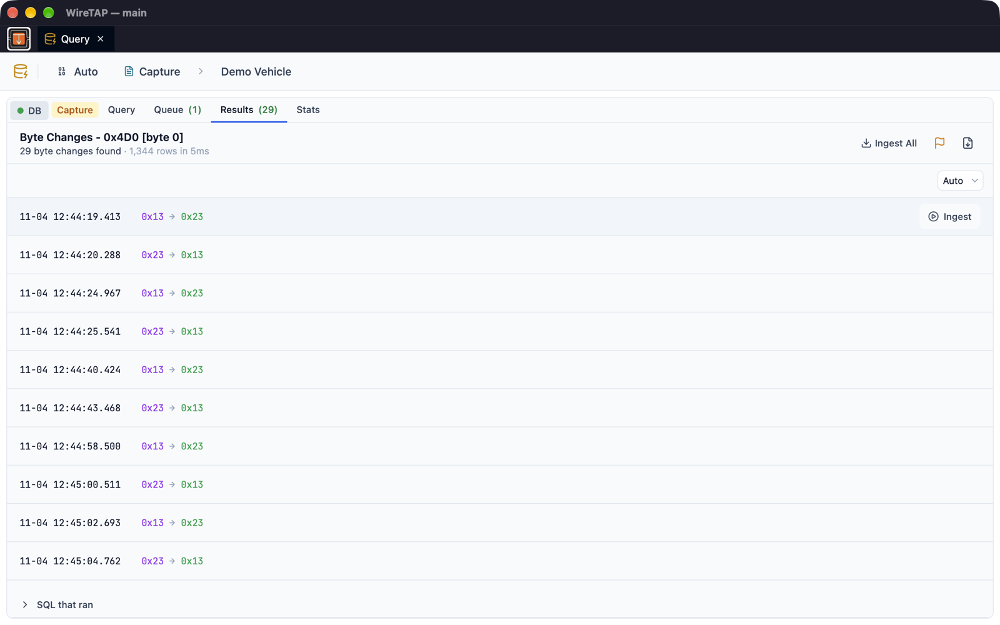

# Query

The Query panel searches recorded CAN data for specific events and lets you ingest the results into other apps for visualisation.

## Overview

Query runs analytical queries against historical frames to find events like byte value changes, payload transitions, transmission gaps and mirror frame mismatches. It reads from two kinds of source: a WireTAP backend profile (the long-term archive kept by [WireTAP Server](wiretap-server.md), reached over its HTTP API with an API key) or a local capture. Results can be ingested back into the session system, allowing the Decoder and Dashboard apps to visualise the surrounding frames.

## Getting Started

1. **Choose a Source** — Open the Data Source picker from the top bar and select a WireTAP backend profile or a capture
2. **Load a Catalog** (optional) — Select a TOML catalog to enable signal-aware frame selection
3. **Configure a Query** — Choose a query type and set parameters on the Query tab
4. **Add to Queue** — Click "Add to Queue" to submit the query
5. **View Results** — Switch to the Results tab when the query completes
6. **Ingest** — Click "Ingest" on any result row to load surrounding frames into other apps

## Query Types

| Type | Description |
|------|-------------|
| Byte Changes | Find when a specific byte in a frame changed value |
| Frame Changes | Find when any byte in a frame's payload changed |
| Mirror Validation | Find timestamps where mirror frames don't match their source |
| Mux Statistics | Per-mux-case min/max/average statistics for each byte position |
| First/Last Occurrence | Find the first and last occurrence of a frame |
| Frame Frequency | Analyse transmission frequency over time buckets |
| Value Distribution | Find all unique values for a byte |
| Gap Analysis | Find transmission gaps longer than a threshold |
| Pattern Search | Search for a byte pattern (`??` as a wildcard) across all frame IDs |
| Frame Inventory | Every frame ID in the source with its count, first and last sighting |

## Interface Elements

### Query Tab

Configure and submit queries:

| Control | Description |
|---------|-------------|
| Query type | Select the analysis type from the dropdown |
| Frame ID | Pick from catalog or enter manually (hex/decimal) |
| Signal / Byte index | Select signal from catalog (auto-calculates byte position) or enter manually |
| Mirror frame | For mirror validation — auto-resolves source frame via catalog `mirrorOf` metadata |
| Extended | Filter by standard (11-bit) or extended (29-bit) frame IDs |
| Tolerance | Time window for matching mirror/source frame pairs (milliseconds) |
| Mux selector byte, payload length | For mux statistics, with an option to include 16-bit word statistics (LE and BE) |
| Gap threshold / Bucket size | For gap analysis and frame frequency (milliseconds) |
| Byte pattern | For pattern search, hex bytes with `??` wildcards (e.g. `AA ?? BB CC`) |
| Time bounds | Optional start/end times — leave blank to search entire history |
| Context window | How much data to load when ingesting a result (presets: ±1s, ±5s, ±30s, ±1m, or custom before/after) |
| Limit results to | Maximum results returned (100–100,000; the default comes from Settings) |
| SQL query preview | Collapsible, read-only view of what will run: the SQLite for a capture, or the request sent to a WireTAP backend |

### Queue Tab

Track submitted queries:
- Each query shows its status: pending, running, completed, or error
- Completed queries display result count and execution time
- Click a query to view its results
- Delete queries individually (cancels if still running)
- Queries execute sequentially — one at a time
- The queue is shared by every window and keeps its results

### Results Tab

Browse and act on query results:

| Query Type | Result Row Contents |
|------------|---------------------|
| Byte Changes | Timestamp, old value → new value |
| Frame Changes | Timestamp, changed byte indices |
| Mirror Validation | Mirror timestamp, Δ time delta, payload comparison with mismatches highlighted |

The other query types show their own summaries (for example, a statistics table for mux statistics, or first and last occurrence cards). A note appears beside the count when a query stopped at its limit and more results may exist.

**Actions:**
- **Ingest** — Click on any result row to load frames around that timestamp (using the configured context window) into the session system
- **Ingest All** — Load the entire results time range at once
- **Add event** — Mark the results time range as an event on the source
- **Export** — Save the results as CSV

The SQL that ran is shown with the results. Results are paginated (Auto, which fills the panel, or 20, 50 or 100 rows per page).

### Stats Tab

Monitor database activity on a WireTAP backend source (not available for captures):
- **Running Queries** — PID, user, duration (colour-coded), query text, and cancel button
- **Connected Sessions** — PID, user, application, state, client address, and terminate button
- Auto-refresh interval: manual, 5s, 10s, or 30s

Shows activity from everything using the same backend database, not just this WireTAP instance.

## Events

Mark discovered time ranges for later:

1. Run a query and view results
2. Click the **Add event** button in the results toolbar
3. The event covers the results time range; add a note and save it

Events belong to the source: a capture keeps its own, and a WireTAP backend keeps them on the gateway so every machine reading that archive sees them. They are listed in the Events app.

## Catalog Integration

Loading a catalog enables:
- **Signal-aware frame selection** — Pick frames and signals from a dropdown instead of entering IDs manually
- **Automatic byte index** — Selecting a signal auto-calculates `byteIndex = floor(startBit / 8)`
- **Mirror frame resolution** — Catalog `mirrorOf` metadata auto-populates source frame ID for mirror validation queries

## Tips

- Run a Frame Inventory first to see what a source holds before asking it anything specific
- Use the SQL preview to understand exactly what query will run before submitting
- Start with narrow time bounds and increase if no results are found
- Set a small context window (±1s) for precise event inspection, or larger (±1m) for broader context
- Use the Stats tab to monitor long-running queries and cancel if needed
- Mark important time ranges as events during investigation for quick reference later
- Mirror validation is useful for verifying redundant CAN bus architectures

## See Also

- [Discovery](discovery.md) — Capture raw frames
- [Decoder](decoder.md) — Decode signals in tabular form
- [Dashboard](dashboard.md) — Visualise signals as charts
- [Settings](settings.md#io-profiles) — Configure WireTAP backend profiles
- [WireTAP Server](wiretap-server.md) — The backend that holds the long-term archive
