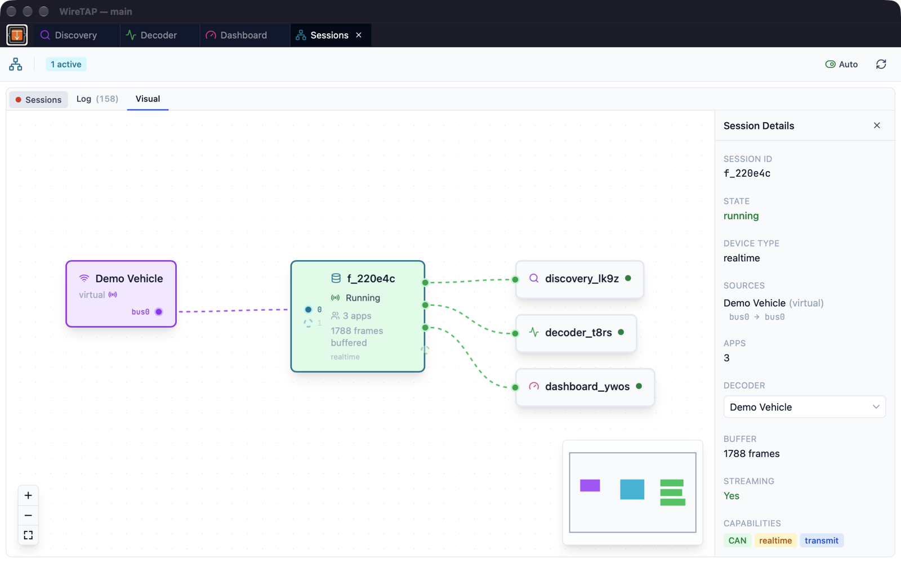

# Sessions

The Sessions app (the Session Manager) provides real-time visualisation and control of all active IO sessions across WireTAP.

## Overview

The Session Manager displays a node graph showing how data flows from sources through sessions to the apps using them. It provides controls for starting, stopping, and reconfiguring sessions, wiring buses and apps, and monitoring session events through a detailed log.

## Interface

The app opens on the **Log** tab; the node graph is on the **Visual** tab.

### Visual Tab

A node graph with three columns showing the data flow:

| Column | Node Type | Colour | Description |
|--------|-----------|--------|-------------|
| Left | Source | Purple | IO profiles feeding data (e.g., GVRET, gs_usb, MQTT, a WireTAP backend), with a port per bus |
| Centre | Session | Cyan | Active sessions, with their input and output buses |
| Right | App | Green port | Apps connected to sessions (Discovery, Decoder, Dashboard, etc.) |

Edges connect source buses to sessions and sessions to apps. Animated edges indicate active streaming. Interface labels on edges show bus mappings (e.g., `bus0 → bus1`). Open apps that are not on any session are shown faded with a dashed border.

**Interactions:**
- Click a node or an edge to view its details in the right panel
- Click the canvas background to deselect
- Drag from a source's bus onto a session to wire that bus into it, or from a session onto an app to connect the app; a connection that already exists, or onto an output bus already in use, is refused
- Drag a node to move it; it keeps its place when the graph updates
- Drag to pan, scroll to zoom, and use the zoom controls and minimap for navigation

### Detail Panel

Clicking a node reveals details and actions in the right panel:

**Session Details:**

| Field | Description |
|-------|-------------|
| Session ID | Full identifier |
| State | Running, Stopped, Paused, or Error (colour-coded) |
| Device Type | e.g., `realtime`, `capture`, `wiretap` |
| Sources | Profiles feeding the session, with their bus mappings |
| Apps | Number of connected apps |
| Decoder | The catalog attached to the session (selectable) |
| Buffer | Frame count of the session's capture |
| Streaming | Whether data is flowing |
| Capabilities | Badges for protocols, realtime, transmit, pause, time-range |

**Session Actions:**

| Action | Description |
|--------|-------------|
| Start | Begin streaming (shown when stopped) |
| Stop | Halt streaming |
| Pause | Suspend streaming (if supported) |
| Resume | Continue from paused state |
| Add Source | Add another device to a live (realtime) session |
| Destroy | Terminate the session entirely |

Below the actions, **Connect App** lists open apps that are on no session, to join them to this one.

**Source Details:** Profile name, ID, device type, preferred decoder and bus mappings. A bus mapping can be removed, and a source can be removed from a multi-source session (when more than one source is present). A Virtual Device also shows its signal generator controls, with **Save to Profile**.

**App Details:** App ID, session, active/inactive status, registration time and window. **Remove** evicts the app from its session. An app on no session offers **Connect to Session**.

**Connection Details:** Clicking an edge shows what it connects, with **Disconnect** to remove it.

### Log Tab

A searchable, filterable event log for debugging and monitoring. The log is kept by the backend, so it survives a reload, every window shows the same log, and clearing it clears it everywhere.

**Event Categories:**

| Category | Events |
|----------|--------|
| Lifecycle | Created, joined, left, destroyed |
| Stream | State change, transition, ended, complete, error, speed |
| Status | Reconfigured, capture, stats, device connected, probe, MCP connect and disconnect |

**Log Controls:**

| Control | Description |
|---------|-------------|
| Events filter | Toggle visibility by event category or type |
| Session filter | Show events for a specific session only |
| Search | Filter entries by text across all fields |
| Profile column | Toggle profile name visibility |
| Scroll to bottom | Keep the latest entries in view |
| Copy | Copy filtered entries to clipboard |
| Clear | Remove all log entries |

Each log entry shows timestamp (HH:MM:SS.mmm), event type with colour badge, session ID, and details; a join or leave names the app. The log keeps the latest 500 entries.

### Top Bar

| Element | Description |
|---------|-------------|
| Active count | Badge showing number of active sessions |
| Auto | Toggle automatic refresh (2-second interval, on by default) |
| Refresh | Manual refresh button |

## Session Lifecycle

Sessions follow this state flow:

1. **Created** — An app requests a source profile via the IO session system, and the session starts on its own
2. **Running** — Data is streaming from the source to all connected apps
3. **Paused** — Streaming temporarily suspended (if the source supports it, such as a capture replay)
4. **Stopped** — Streaming halted, capture finalised
5. **Destroyed** — Session terminated, all apps disconnected

The Rust backend automatically destroys a session when its last app leaves.

## Multi-Source Sessions

The Session Manager is the primary interface for multi-source session control:

- View all profiles feeding a session as separate source nodes
- Add sources dynamically via the **Add Source** button
- Remove individual sources (when more than one is present)
- Wire or remove individual buses by dragging on the graph or from the detail panel
- Interface labels show bus-to-bus mappings on edges

## App Icons

Each app node displays an icon identifying the connected app:

| App | Icon |
|-----|------|
| Discovery | Search |
| Decoder | Activity |
| Transmit | Send |
| Dashboard | Gauge |
| Events | Flag |
| Query | Database |

## Tips

- Use the Visual tab to understand which apps share a session — apps on the same session receive the same frames
- Check the Log tab to diagnose connection issues or unexpected session behaviour
- Enable auto-refresh to monitor sessions during live capture
- Use **Destroy** to clean up stuck sessions that aren't responding to stop commands
- The Log tab's search and filter tools are useful for tracing specific session events during debugging

## See Also

- [Discovery](discovery.md) — Capture raw frames
- [Decoder](decoder.md) — Decode signals using catalogs
- [Dashboard](dashboard.md) — Visualise signals as charts
- [Settings](settings.md) — Configure IO profiles
